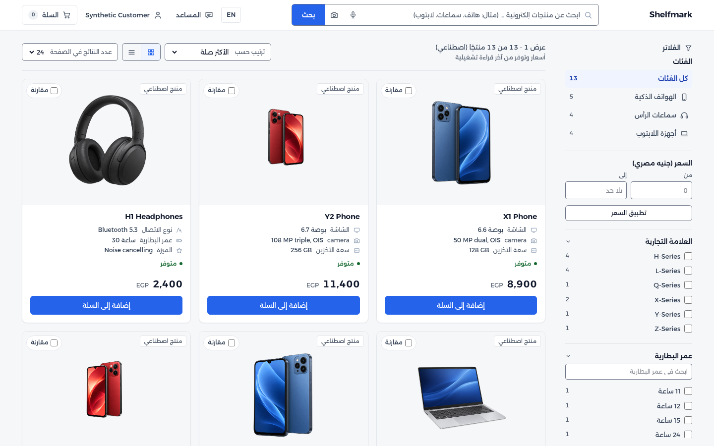
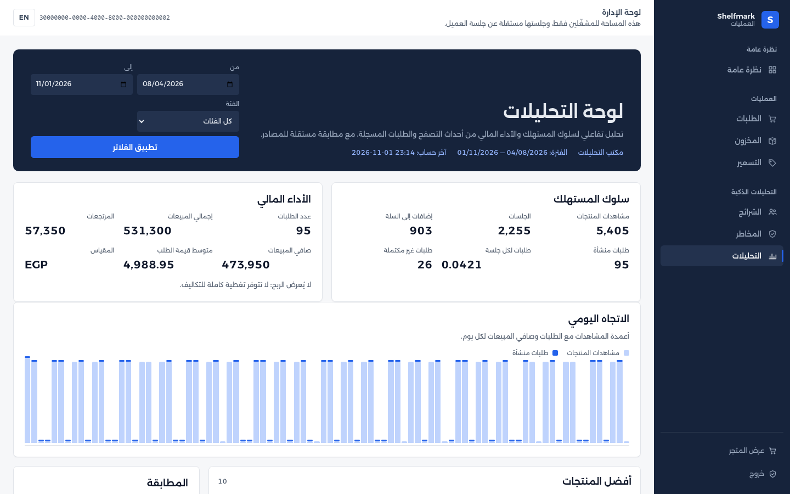

# Shelfmark

**Shelfmark: An AI-Powered Smart E-Commerce Management System** — an online
electronics shop with a smart assistant, plus the operator back office behind it.

It has two halves that share the same data:

- **Storefront** for customers — browse and compare products, ask the AI
  assistant, search by photo or by voice, add to cart, check out, and track an
  order. Arabic-first with full English support.
- **Back office** for staff — forecast stock and reorder, adjust prices, segment
  customers, review risky orders, and read business dashboards.

Everything runs on your own computer with one command. This guide assumes you
have never used a terminal before.

<p>
  
  
</p>

<sub>Screens captured from the running system. All product and order data is
synthetic and labelled as such.</sub>

---

## Run it — Windows (start here)

You only need to install **one** thing: Docker Desktop. Everything else runs
inside Docker.

### What you need

- Windows 10 or 11, 64-bit.
- 8 GB of RAM (16 GB is comfortable) and about 6 GB of free disk space.
- An internet connection for the first run.

### Step 1 — Install Docker Desktop

1. Go to <https://www.docker.com/products/docker-desktop/> and click **Download
   for Windows**.
2. Open the downloaded file (`Docker Desktop Installer.exe`) and click **OK /
   Install**. Leave the **"Use WSL 2 instead of Hyper-V"** box checked.
3. If it asks to restart, restart the computer.
4. Launch **Docker Desktop** from the Start menu. Wait until the little whale
   icon in the taskbar stops animating — it says **"Engine running"** when ready.
   You can leave Docker Desktop open in the background.

> If Windows asks you to install a "WSL 2 kernel update", click the link it
> offers, install that, then reopen Docker Desktop.

### Step 2 — Get the project

You do **not** need Git. On the [project page](https://github.com/adham-samir/shelfmark):

1. Click the green **Code** button → **Download ZIP**.
2. Right-click the downloaded `shelfmark-main.zip` → **Extract All…** → **Extract**.
3. Open the extracted `shelfmark-main` folder. You should see folders named
   `apps`, `infra`, `services`, and `docs`.

### Step 3 — Open a terminal in that folder

In the `shelfmark-main` folder window, click the address bar at the top (where
the path is), type `powershell`, and press **Enter**. A blue/black window opens,
already pointed at this folder. That window is the **terminal**.

> Alternative: hold **Shift**, right-click any empty space inside the folder, and
> choose **Open PowerShell window here**.

### Step 4 — Start the app

In that terminal window, copy this line, paste it, and press **Enter**:

```powershell
docker compose -f infra/compose.yaml up --build
```

- The **first run takes several minutes** while it downloads and builds things
  (roughly 2 GB, once). It will scroll a lot of text — that is normal.
- When it settles and you can see a line containing `ready`, it is running.
- **Leave this window open** while you use the app.

### Step 5 — Open the shop

Open your browser and go to <http://localhost:3000>.

### Step 6 — Sign in

The demo accounts are ready to use:

| Role     | Email                      | Password          |
|----------|----------------------------|-------------------|
| Customer | `customer@example.invalid` | `demo-customer-1` |
| Operator | `operator@example.invalid` | `demo-operator-1` |

The customer signs in at **/login**; the operator back office is at
**/backoffice/login**.

### Step 7 — Stop the app

- Go back to the terminal window and press **Ctrl + C**, or
- Open a new terminal in the same folder and run:

```powershell
docker compose -f infra/compose.yaml down
```

To start it again later, repeat **Step 4** (it will be much faster the second
time). You do not need to repeat Steps 1–3.

---

## Run it — Linux

The commands are identical to Windows from Step 2 onward. Only the install step
differs.

### Step 1 — Install Docker

On Ubuntu/Debian, the simplest path is Docker's official convenience script:

```bash
curl -fsSL https://get.docker.com | sudo sh
```

Then let your user run Docker without `sudo` (log out and back in for it to take
effect):

```bash
sudo usermod -aG docker "$USER"
```

Check it works:

```bash
docker compose version
```

> If you would rather not use the convenience script, follow
> <https://docs.docker.com/engine/install/> for your distribution.

### Step 2 — Get the project

```bash
git clone https://github.com/adham-samir/shelfmark.git
cd shelfmark
```

(No Git? Download the ZIP from the project page and extract it, then `cd` into
the extracted folder.)

### Step 3 — Start the app

```bash
docker compose -f infra/compose.yaml up --build
```

Wait for the first run to finish downloading and building (a few minutes), then
open <http://localhost:3000> and sign in with the same demo accounts as above.

### Step 4 — Stop the app

Press **Ctrl + C** in the terminal, or from another terminal:

```bash
docker compose -f infra/compose.yaml down
```

---

## Turn on the AI assistant (optional)

The assistant and voice-search pages work but show a friendly "provider
unavailable" message until you give the app a key. Everything else works without
one.

The example settings already point at OpenRouter and a cheap DeepSeek model, so
you only need to add your own key:

1. In the project folder, make your own settings file from the example.
   - **Windows (PowerShell):** `copy .env.example .env`
   - **Linux:** `cp .env.example .env`
2. Open `.env` in a text editor (Notepad is fine) and paste your key:

   ```text
   OPENAI_API_KEY=sk-or-v1-your-key-here
   ```

   The variable keeps the OpenAI SDK's name whatever gateway sits behind it. To
   use OpenAI instead, clear `SMART_ECOMMERCE_OPENAI_BASE_URL` and set OpenAI
   model ids; any other OpenAI-compatible gateway works the same way.

3. Save the file, then restart the app:

   ```bash
   docker compose -f infra/compose.yaml down
   docker compose -f infra/compose.yaml up
   ```

> `.env` is ignored by Git, so your key is never uploaded. Never share it.

---

## Troubleshooting

**"docker : The term 'docker' is not recognized" (Windows) or
"docker: command not found" (Linux).**
Docker is not installed, or Docker Desktop is not running. On Windows, open
Docker Desktop and wait for "Engine running".

**"port is already allocated" / "address already in use".**
Something else is using port 3000 (the shop) or 8000 (the API). Close the other
program, or edit `infra/compose.yaml` and change `"3000:3000"` to `"3001:3000"`
(the left number is the one on your computer).

**It seems stuck, or the data looks wrong.**
Reset the demo data completely and start clean:

```bash
docker compose -f infra/compose.yaml down -v
docker compose -f infra/compose.yaml up --build
```

The `-v` deletes the demo databases so they are re-created and re-seeded fresh.

**The first run is very slow.**
It is downloading images (about 2 GB) and building the app. Later runs are much
faster.

**I closed the terminal.**
The app stops when you close it. Reopen a terminal in the project folder and run
the **Step 4** start command again.

---

## What's inside

| Area | Highlights |
|---|---|
| Customer storefront | Catalog with filters, product detail, comparison, cart, retry-safe checkout, order history, saved addresses |
| AI shopping assistant | Answers questions, suggests products, keeps the thread of the conversation, and can attach one of your own orders to ask about it |
| Smart search | Photo search, voice search, and dynamic filters |
| Predictive inventory (BO-01) | 14-day demand forecast and automatic reorder through a supplier simulator |
| Dynamic pricing (BO-02) | Bounded price changes from supply, demand, cost, and season |
| Customer segmentation (BO-03) | RFM segments with a documented rule set and CSV export |
| Fraud detection (BO-04) | Pre-checkout risk scoring with an operator review queue |
| Business intelligence (BI-01) | Consumer and financial dashboards that reconcile to the orders |

Built with Next.js, React, and Tailwind CSS; Python and FastAPI; PostgreSQL and
MongoDB; Scikit-learn, PyTorch, and the OpenAI API; Docker.

## Project documentation

- [Software Requirements Specification](docs/SRS.md) and [requirements traceability](docs/requirements-traceability.md)
- [Architecture diagrams](docs/diagrams/README.md) and [data foundation](docs/architecture/data-foundation.md)
- [API contracts](docs/api/README.md)
- [Design system](DESIGN.md) and [UI/UX specification](docs/ui-ux/README.md)
- [Test report](docs/test-report.md) and [testing guide](docs/testing.md)
- [Decision register](docs/decisions.md) and [progress](docs/progress.md)
- [User manual](docs/user-manual.md), [demo script](docs/demo-script.md), and [final presentation](docs/presentation/README.md)

## For developers

Run the app in the background and develop against it:

```bash
docker compose -f infra/compose.yaml up --build -d
```

Or use the shortcuts in the [`Makefile`](Makefile): `make up`, `make up-d`,
`make down`, `make reset`, `make logs`, `make test`, `make gates` (run `make`
for the list).

The full test/verification commands — API suites, database checks, integration,
security and load, the accessibility gate, and the demo rehearsal — are in
[`docs/testing.md`](docs/testing.md). CI runs the API suite and the storefront
typecheck/tests/build on every push.

Service-level guides: [`services/api/README.md`](services/api/README.md) and
[`apps/storefront/README.md`](apps/storefront/README.md).

## Status and limitations

Stages 1–4 are complete and documented; Stage 5 packaging, deployment guidance,
the user manual, the demo script, and the presentation are delivered. The
remaining work needs outside access and is stated honestly rather than implied:

- The assistant is proven live through OpenRouter with
  `deepseek/deepseek-v4.1-flash` — grounded answers, own-order lookup, and
  conversation memory. Voice transcription is still exercised with an injected
  provider only; no real speech sample has been run through it.
- No cloud deployment — AWS placement needs an account.
- Accessibility is verified by automated axe-core checks; no manual
  screen-reader pass has been run.
- 43 Arabic strings await a native-speaker review.
- Recommendation, forecast, segmentation, pricing, and fraud models are trained
  and evaluated on labelled synthetic data; the results show the pipeline works,
  not real-world quality.

Details and per-requirement evidence are in the [test report](docs/test-report.md)
and [progress](docs/progress.md).
