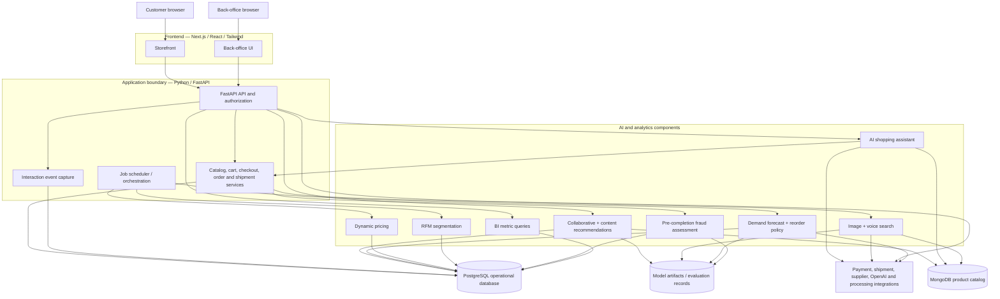

# UML Logical Component View

Arrows show required communication/data dependencies, not mandated deployment units. The accepted starting arrangement is one Next.js application and one modular Python/FastAPI backend; background execution can share domain code. Docker and AWS are selected; service placement remains deployment work.
