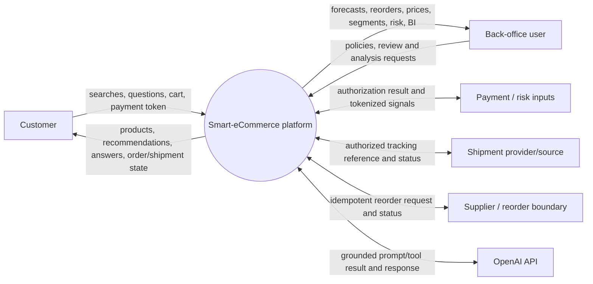
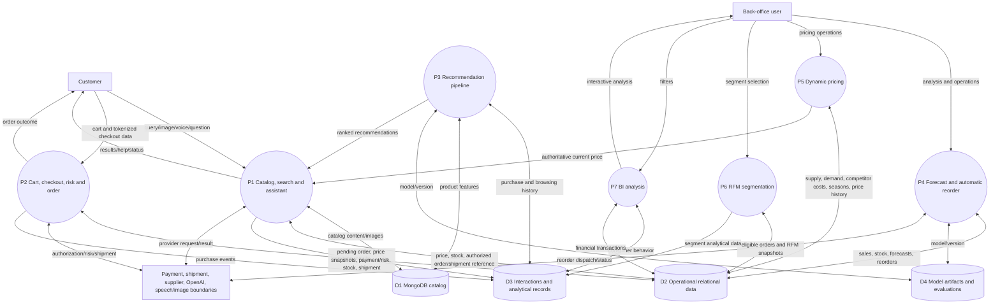

# Data Flow Diagrams

## Level 0 — system context

## Level 1 — stores, processes, and integrations

The data-flow views deliberately label external providers as boundaries because provider choices and live/sandbox scope are unresolved decisions.
