# Conceptual Entity-Relationship Diagram

```mermaid
erDiagram
    CUSTOMER ||--o{ BROWSING_EVENT : generates
    CUSTOMER ||--o{ ORDER : places
    CUSTOMER ||--o{ RFM_SNAPSHOT : receives
    CUSTOMER ||--o{ RECOMMENDATION_RUN : requests

    PRODUCT ||--o{ BROWSING_EVENT : concerns
    PRODUCT ||--o{ ORDER_ITEM : snapshots
    PRODUCT ||--|| INVENTORY_BALANCE : has
    PRODUCT ||--o| CURRENT_PRICE : priced_by
    PRODUCT ||--o{ INVENTORY_MOVEMENT : records
    PRODUCT ||--o{ DEMAND_FORECAST : predicts
    PRODUCT ||--o{ REORDER : replenishes
    PRODUCT ||--o{ PRICING_OBSERVATION : evaluates
    PRODUCT ||--o{ PRICE_CHANGE : changes
    PRODUCT ||--o{ RECOMMENDATION_ITEM : recommends

    ORDER ||--|{ ORDER_ITEM : contains
    ORDER ||--o{ PAYMENT_TRANSACTION : attempts
    ORDER ||--o| SHIPMENT : produces
    PAYMENT_TRANSACTION ||--o{ RISK_ASSESSMENT : assessed_by
    DEMAND_FORECAST ||--o{ REORDER : triggers
    RECOMMENDATION_RUN ||--|{ RECOMMENDATION_ITEM : ranks
    MODEL_VERSION ||--o{ DEMAND_FORECAST : produced
    MODEL_VERSION ||--o{ RISK_ASSESSMENT : produced
    MODEL_VERSION ||--o{ RECOMMENDATION_RUN : produced
    MODEL_VERSION ||--o{ EVALUATION_RUN : evaluated_by

    CUSTOMER {
        uuid customer_id PK
        string identity_reference UK
    }
    PRODUCT {
        uuid product_id PK "MongoDB _id is canonical text of this UUID"
        string lifecycle "draft, active, archived"
    }
    CURRENT_PRICE {
        uuid product_id PK,FK
        decimal amount "exact numeric 20,6"
        string currency "explicit; no default"
        bigint version
        datetime updated_at
    }
    BROWSING_EVENT {
        uuid event_id PK
        uuid customer_id FK
        string product_id FK
        string event_type
        datetime occurred_at
        string provenance_class
    }
    ORDER {
        uuid order_id PK
        uuid customer_id FK
        string status
        string currency
        datetime created_at
    }
    ORDER_ITEM {
        uuid order_item_id PK
        uuid order_id FK
        string product_id FK
        decimal unit_price_snapshot
        int quantity
    }
    PAYMENT_TRANSACTION {
        uuid transaction_id PK
        uuid order_id FK
        string provider_token_reference
        string status
    }
    RISK_ASSESSMENT {
        uuid assessment_id PK
        uuid transaction_id FK
        string model_version_id FK
        decimal risk_score
        string outcome
        datetime assessed_at
    }
    SHIPMENT {
        uuid shipment_id PK
        uuid order_id FK
        string provider_reference
        string status
        datetime status_at
    }
    INVENTORY_BALANCE {
        uuid product_id PK,FK
        int on_hand
        int reserved
        int available "generated: on_hand minus reserved"
        bigint version
        datetime updated_at
    }
    INVENTORY_MOVEMENT {
        uuid movement_id PK
        string product_id FK
        int quantity_delta
        string reason
        datetime occurred_at
    }
    DEMAND_FORECAST {
        uuid forecast_id PK
        string product_id FK
        string model_version_id FK
        date horizon_start
        date horizon_end
        decimal predicted_quantity
    }
    REORDER {
        uuid reorder_id PK
        string product_id FK
        uuid forecast_id FK
        string idempotency_key UK
        int quantity
        string status
    }
    PRICING_OBSERVATION {
        uuid observation_id PK
        string product_id FK
        decimal supply_value
        decimal demand_value
        decimal competitor_cost
        string season_id
        datetime observed_at
    }
    PRICE_CHANGE {
        uuid price_change_id PK
        string product_id FK
        decimal old_price
        decimal new_price
        datetime applied_at
        string calculation_version
    }
    RFM_SNAPSHOT {
        uuid snapshot_id PK
        uuid customer_id FK
        date reference_date
        decimal recency
        decimal frequency
        decimal monetary
        string segment
    }
    RECOMMENDATION_RUN {
        uuid run_id PK
        uuid customer_id FK
        string model_version_id FK
        datetime created_at
    }
    RECOMMENDATION_ITEM {
        uuid run_id FK
        string product_id FK
        int rank
        decimal combined_score
    }
    MODEL_VERSION {
        string model_version_id PK
        string module
        string dataset_snapshot_id
        string artifact_reference
    }
    EVALUATION_RUN {
        uuid evaluation_id PK
        string model_version_id FK
        string dataset_snapshot_id
        string metrics
    }
```

This is the whole-system conceptual ERD. Migrations 0001–0010 implement its operational baseline in PostgreSQL, including customer/access, browsing, cart/order snapshots, payment/risk review, shipment events/contact, inventory movement, forecasting/reorder audit evidence, pricing observations/history, RFM, model/evaluation records, recommendation runs/items, demo credentials/sessions, and the audited order-lifecycle records. Descriptive products remain in MongoDB. See [data foundation](../architecture/data-foundation.md).
