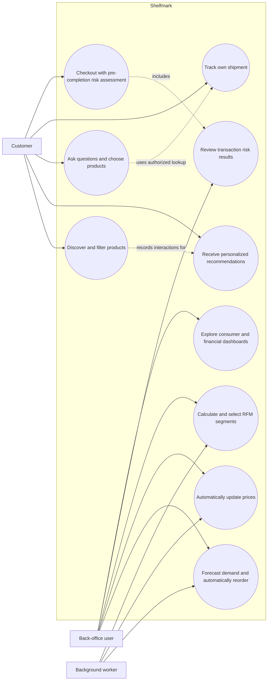

# UML Use-Case View

The diagram defines the two accepted human access boundaries from DEC-006: ownership-scoped customers and capability-scoped back-office users. It does not invent a larger role hierarchy.
