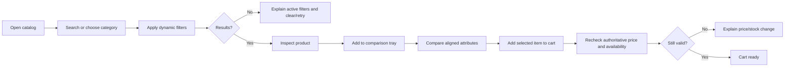
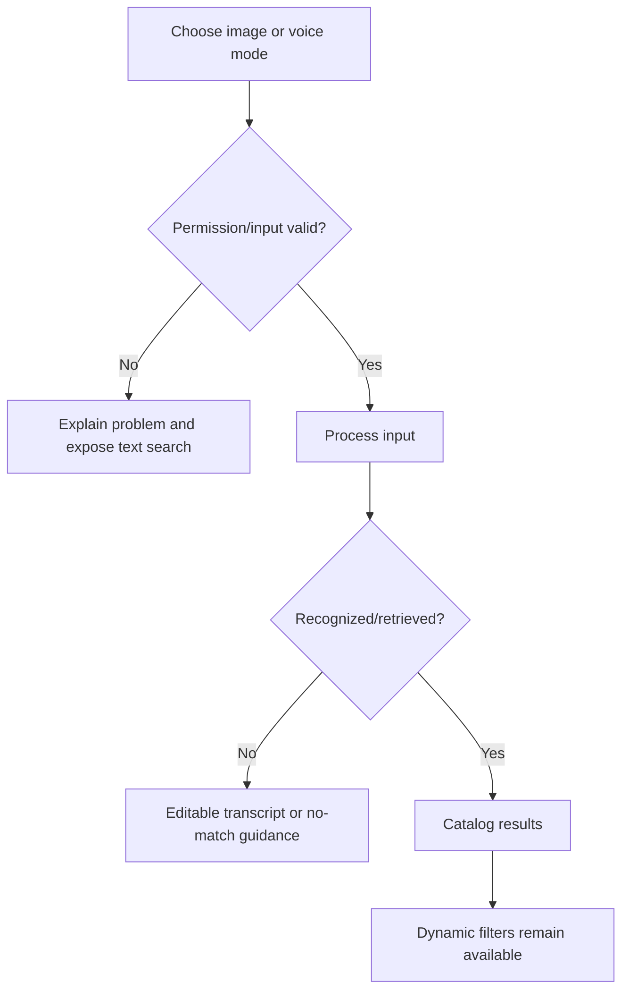
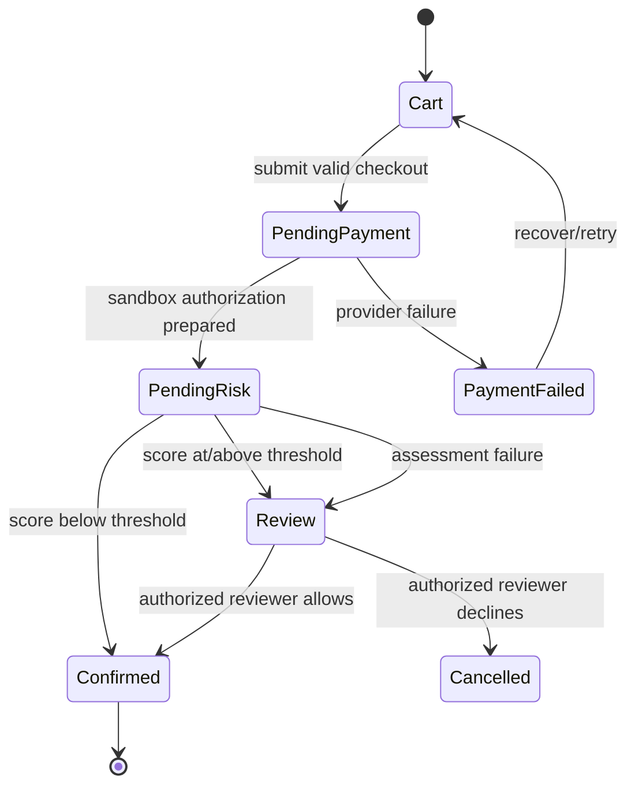
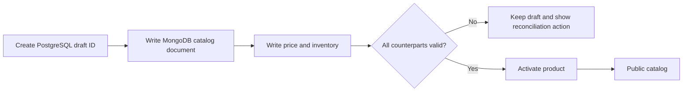

# UI flows and state transitions

## Discovery, compare, and cart

## Image and voice search recovery

## Checkout and pre-completion risk

## Catalog publication/reconciliation

## Figma status

Figma wireframes and click-through links are pending external tool access. The approved comp, routes, controls, flows, and state requirements in this directory are the source-of-truth implementation specification until a Figma artifact is created and linked here.
